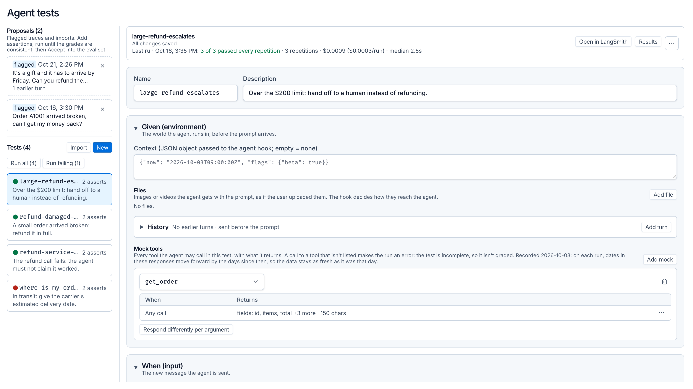

# Eval editor

A test editor for LangChain agents, backed by a LangSmith dataset. Tests read like unit tests: **Given** a world, **When** the agent gets a message, **Assert** what must be true of what it did.

- **Given** is everything that is true before the message arrives:
  - **Context**: an opaque JSON object your hook uses to set the agent up (business record, a frozen clock, feature flags…).
  - **History**: earlier turns of the conversation.
  - **Mock tools**: every tool the agent may call, with what it returns. A mock can return one response, a different response per argument value, a different response per call, or a failure (`{"raise": "503 ..."}`).
- **When** is the new message sent to the agent.
- **Assert** comes in two kinds:
  - **Assertions**: named one-sentence statements ("It never says or implies that the refund was issued."), graded by an LLM judge against the run.
  - **Code checks**: deterministic checks a judge can't grade from a transcript, such as `must_call`, `max_tool_calls` or `max_prompt_tokens`.

**Run test** runs the real agent against the mocks several times in parallel and logs one LangSmith experiment. **Run all** and **Run failing** run many tests, 4 at a time. The test list works like an IDE's test explorer:

- **Each test has a status dot** for its newest result: green (passed every repetition), amber (passed some), red (failed every repetition) or a red **!** (the run errored, e.g. an incomplete test).
- **Each assertion and code check shows its last result** inline (`3/3`, `1/3`, `0/3`).
- **The test header shows the last run**: when, how it went, total and per-run cost, median time, and the agent commit.
- **Out-of-date results are marked.** If the test was edited after its last run, or the agent's code changed, the results are flagged instead of passed off as current.



The UI runs either as a normal web app served by the eval server (**standalone**, the default) or inside LangSmith as a **custom app**. Both use the same `App.tsx`.

```
app/          the editor (React + Macaw). Two builds: web (dist-web/) and custom app (dist/bundle.js)
server/
  hook.py         how the harness runs YOUR agent: the one file to change for another agent
  agent_hook.py   loads the hook (EVAL_HOOK picks another module, e.g. one that lives in your agent's repo)
  demo_agent.py   a small customer-support agent (orders, shipping, refunds) to demo on
  mocks.py        test mocks, applied as LangChain middleware; strict replay
  checks.py       code checks (deterministic assertions)
  harness.py      runs tests via langsmith.evaluate: repetitions, judge, code checks
  seed.py         creates the dataset with four starter tests
  main.py         FastAPI: serves the web build, proxies the LangSmith API, runs tests, receives the webhook
  run_queue.py    custom-app mode: reads run requests from a Context Hub prompt repo
  register_webhook.py  custom-app mode: creates that repo and its commit webhook
```

## Run it (standalone)

Needs Python 3.11+ with [uv](https://docs.astral.sh/uv/) and Node 22.12+.

```bash
cd server
cp .env.example .env        # LANGSMITH_API_KEY and ANTHROPIC_API_KEY
uv sync
```

```bash
cd app && npm install && npm run build:web
```

```bash
cd server && uv run uvicorn main:app --port 8765
```

Open http://localhost:8765. On first start the server creates the `eval-editor-demo` dataset with four tests. Pick one and click **Run test**.

For UI work, `npm run dev:web` in `app/` serves the editor with hot reload on http://localhost:5173 and proxies `/api` to the server.

To populate **Import** (turn a real run into a test), run the agent a few times; its traces go to the `eval-editor-demo-agent` project:

```bash
cd server && uv run python demo_agent.py "Where is my order A1002?"
```

From the command line, `uv run python harness.py [test names] -r 3` runs tests without the UI. `uv run pytest` tests the mocks, code checks and harness.

## How a test runs

1. `harness.target` builds a `MockTools` from the test's `inputs.mock_tools` and calls `hook.run_agent(prompt, mocks, history=…, context=…)`. `history` and `context` are passed only when the test sets them, so hooks written before they existed still work.
2. `hook.run_agent` runs the agent with `mocks.middleware()`, which answers every tool call from the mocks. Real tools never execute.
3. **Replay is strict.** A call to a tool the test doesn't mock, or with arguments no case matches, makes the run an **error** ("Test incomplete: no mock answered …"), with no grades. The test is what needs fixing. Anything the agent did after answering an error the test never wrote says nothing about the agent.
4. **Only this turn is graded.** The hook returns the replayed history first, then this turn's messages. The harness finds the turn by the prompt's own message rather than by counting history, because an agent that summarizes a long thread returns fewer messages than it was given.
5. **Dates shift.** Dates in mock responses (strings starting `YYYY-MM-DD`) move forward by the days since `inputs.recorded_on`, so recorded data looks exactly as fresh on every run. Leave `recorded_on` out if your context freezes the agent's clock instead.
6. **Grading.** Assertions are graded in one judge call. The judge sees what the agent started from (`given`: the context and the last few history turns), its final answer, its messages and its tool calls. Code checks are graded in code. Each assertion or check name becomes a feedback key with score 1 or 0 and a one-sentence reason.
7. **Repetitions.** `evaluate(..., num_repetitions=n, max_concurrency=n)` runs the repetitions in parallel as one experiment, named after the test and tagged with the test's `example_id`. Mocks live inside each run, so tests also run side by side.

A test is one dataset example:

```json
{
  "inputs": {
    "context": {"customer_tier": "gold"},
    "history": [
      {"role": "user", "content": "Hi, I have a problem with an order."},
      {"role": "assistant", "content": "Sorry to hear that. Which order?"}
    ],
    "prompt": "Order A1001 showed up broken. Please refund it.",
    "recorded_on": "2026-10-03",
    "mock_tools": {
      "get_order": {"id": "A1001", "status": "delivered", "total": 42.5},
      "get_shipping_status": {"cases": [{"when": {"tracking_number": "1Z9"}, "response": {"eta": "2026-10-06"}}]},
      "issue_refund": {"raise": "503 Service Unavailable"}
    }
  },
  "outputs": {
    "assertions": [{"name": "no-false-claim", "assertion": "It never says or implies that the refund was issued."}],
    "checks": [{"name": "looks-up-the-order", "type": "must_call", "tools": ["get_order"]}]
  },
  "metadata": {"name": "refund-service-down", "description": "The refund call fails.", "dataset_split": ["base"]}
}
```

`context`, `history` and `checks` are optional. The editor leaves them out when they're empty, and so should anything that writes tests. The editor autosaves a test as soon as it's opened if its own save would differ from what's stored.

### Mock shapes

| Shape | Answers |
|---|---|
| `{...}` or `"text"` | The same response to any call |
| `{"cases": [{"when": {"arg": "value"}, "response": ...}, {"response": ...}]}` | The first case whose `when` is a subset of the call's arguments. A case with no `when` matches anything |
| `{"cases": [{"when_any_value": "P1", "response": ...}]}` | A case that matches when **any** argument (nested ones too) equals that value. Use it when the agent may send the same id under different argument names |
| `{"sequence": [r1, r2, ...]}` | A different response per call. The last one repeats |
| `{"raise": "503 ..."}` | The call fails with that message. Usable as a case's response too |

### Code checks

| Type | Params | Passes when |
|---|---|---|
| `must_call` | `tools: [name \| [any, of, these]]` | every entry was called at least once |
| `must_not_call` | `tools: [name]` | none was called |
| `max_tool_calls` | `max`, `tool?` | total calls (or calls to `tool`) ≤ `max` |
| `max_tool_rounds` | `max` | model calls that asked for tools ≤ `max` |
| `must_call_before` | `first`, `second` | if `second` ran, `first` ran before it |
| `must_call_with_values` | `tool`, `args: {arg: value}` | some call to `tool` carried every value |
| `max_prompt_tokens` | `max` | the largest single model call's input ≤ `max` tokens |
| `max_model_calls` | `max` | model calls in the run ≤ `max` |
| `custom` | anything | the hook's `custom_check` says so |

An unknown type scores `None` rather than passing: a typo must never read as a pass. Names are lowercase-with-dashes. Assertions and checks share one namespace, because each name is a feedback key.

## Use it with your agent

Edit `server/hook.py`, or point `EVAL_HOOK` at a module in your agent's own repo and run the server from that repo's environment (see below):

```python
from my_agent import TOOLS, build_agent   # build_agent must accept middleware
from mocks import MockTools

TOOL_NAMES = [t.name for t in TOOLS]       # the "Add mock" dropdown, and which tool runs Import keeps

def run_agent(prompt: str, mocks: MockTools, history=None, context=None) -> list[BaseMessage]:
    agent = build_agent(middleware=[mocks.middleware()], **(context or {}))
    messages = [*(history or []), {"role": "user", "content": prompt}]
    return agent.invoke({"messages": messages})["messages"]
```

For an agent that isn't built on LangChain, call `mocks.call(name, args, tool_call_id)` wherever the agent executes a tool, and return the transcript as LangChain messages.

A hook can also define:

- **`custom_check(outputs, check) -> (passed, reason)`**: grades checks of type `custom`, for anything the built-ins can't express.
- **`judge_model()`**: the chat model that grades assertions. The default is `JUDGE_MODEL`, e.g. to bill grading to your agent's own key.
- **`grade_assertions(assertions, evidence) -> [Grade]`**: replaces assertion grading entirely. For example, a cheap yes/no classifier that hands only the cases it's unsure of to a chat model. A `Grade` with `passed=None` means undecided and is scored `None`, never a pass.

**Keeping the hook in your agent's repo.** Set `EVAL_HOOK` to its module path and run the server from your agent's environment, with this server on `PYTHONPATH`:

```bash
EVAL_HOOK=tests.evals.hook EVAL_DATASET=my-agent-tests PYTHONPATH=.:/path/to/eval-editor/server \
  uv run uvicorn main:app --app-dir /path/to/eval-editor/server --port 8765
```

The server reports that checkout's git commit to the editor. Experiments record the commit they ran on, which is how the editor flags results produced by older agent code.

Then set the names in `server/.env` and `app/.env` (copy each `.env.example`): `EVAL_DATASET` / `VITE_DATASET_NAME` for the dataset, and `VITE_TRACE_PROJECT` for the project Import reads. The server writes the agent's tool names to the dataset's metadata (`agent_tools`) on start, which is where the editor reads them from in both modes. `AGENT_MODEL` and `JUDGE_MODEL` take any `init_chat_model` string.

## Working in the editor

- **Run test / Run all / Run failing.** "Failing" means every test whose newest result is red, amber or errored. Run all and Run failing confirm first, showing the run count and an **estimated cost**: each test's LangSmith-priced cost per repetition on its newest run, times the repetitions chosen. The estimate covers the agent's model calls only (graders trace elsewhere), and tests with no priced run yet are counted separately rather than guessed.
- **Runs go 4 tests at a time.** The server queues the rest (`MAX_PARALLEL_TESTS` in `main.py`), and the list shows each test as queued or running until its result lands.
- **Status dots** come from the dataset's experiment list, newest first, read only until every test has a status. That's usually one request, however many experiments the dataset has run. They refresh every 30 s, and right away when a run finishes.
- **Results** lists every run of the selected test, newest first, with each assertion's and check's score and reason per repetition.
- **Out of date.** A result stops counting as current when the test was edited after the run (the run records the dataset version it used) or when the server's agent commit differs from the run's. Out-of-date dots and chips fade, and the header strikes the last run through with the reason.

## Turn it into a LangSmith custom app

Inside LangSmith the editor runs in a sandboxed iframe: it can call the LangSmith API (through `window.langsmith.call`, under the viewer's own session) and nothing else. Everything except **Run test** already works there, because the web build only reaches LangSmith through a shim with the same `window.langsmith` shape. Run test can't call your server, so it commits the request to a Context Hub prompt repo, and a prompt webhook on that repo wakes the server:

```
Run test ──commit──► prompt repo eval-editor-run-requests ──webhook──► server /hooks/eval-runs
                                                                         │ reads the repo, runs new requests
Results column ◄──── polls experiments on the dataset ◄────────────────── harness.run_tests
```

Each commit's template holds one request as `key: value` lines (`test`, `example_id`, `repetitions`, `requested_at`). Run all and Run failing commit one request per test. The webhook body is a wake-up call only: the server reads the repo and records what it ran in `server/.run-queue-state.json`, so a missed or repeated delivery never loses or doubles a run. Requests already in the repo when the server first starts are marked done.

1. **Expose the webhook route.** The server holds a real API key behind `/api/langsmith`, so expose only `/hooks/eval-runs`, not the whole server. With ngrok and a static domain:

   ```bash
   ngrok http 8765 --url https://<your-domain>.ngrok-free.app
   ```

   Restrict the tunnel to that path with an ngrok traffic policy (deny any request whose path isn't `/hooks/eval-runs`). On a deployed server, route only that path publicly.

2. **Create the requests repo and register the webhook.** This creates `eval-editor-run-requests` (a private prompt repo) and a prompt webhook limited to it (trigger `commit`), sending an `X-Webhook-Secret` header. The secret is generated and written to `server/.env`; restart the server afterwards.

   ```bash
   cd server
   uv run python register_webhook.py --url https://<your-domain>.ngrok-free.app/hooks/eval-runs
   ```

   `--list` shows prompt webhooks and `--delete <id>` removes one. The same webhook can be set up in LangSmith's prompt webhook settings: URL, header `X-Webhook-Secret: <WEBHOOK_SECRET>`, trigger on commit, limited to the requests repo.

3. **Develop and push the app.** Install the [`langsmith` CLI](https://docs.langchain.com/langsmith/custom-apps), then:

   ```bash
   cd app
   langsmith apps dev                          # the app in a real local sandbox, rebuilt on save
   langsmith apps push --name "Agent tests"    # builds dist/bundle.js and publishes it to the workspace
   ```

   The first push writes `app/.langsmith/app.json` with the app's ID; commit it so later pushes update the same app. Pushing publishes to everyone in the workspace.

4. **Keep the server running.** Open the app in LangSmith, click **Run test**: the Results column shows "Requested" until the server picks it up, then each repetition as it's graded.

Custom-app constraints:

- **The bundle must stay under 1 MB** (`langsmith apps dev` refuses larger files). It's ~910 KB. `postcss.config.js` keeps only Latin font subsets. The "⋯" menus are a small hand-rolled `ActionsMenu` because Macaw's DropdownMenu cost ~90 KB.
- **Two features need the web server:** the queued/running markers, and flagging results from older agent code. The custom app can only read LangSmith, so it can't see the server's queue or the agent's current commit. Out-of-date marking for edited tests works in both modes.
- **Links:** the app gets `metadata.workspaceId` and `metadata.host` from LangSmith. It can't navigate itself, so links go through `window.langsmith.openUrl`.
- **Build-time settings:** the dataset name, requests repo and trace project are baked in at build time (`app/.env`).
- **Docs for agents:** `app/AGENTS.md` documents the custom-app API surface for coding agents, and `app/context.md` is the app's handoff notes.
